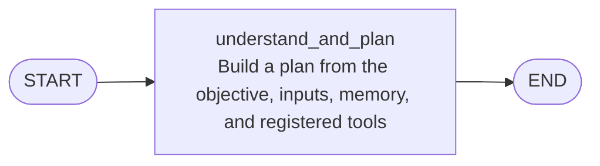
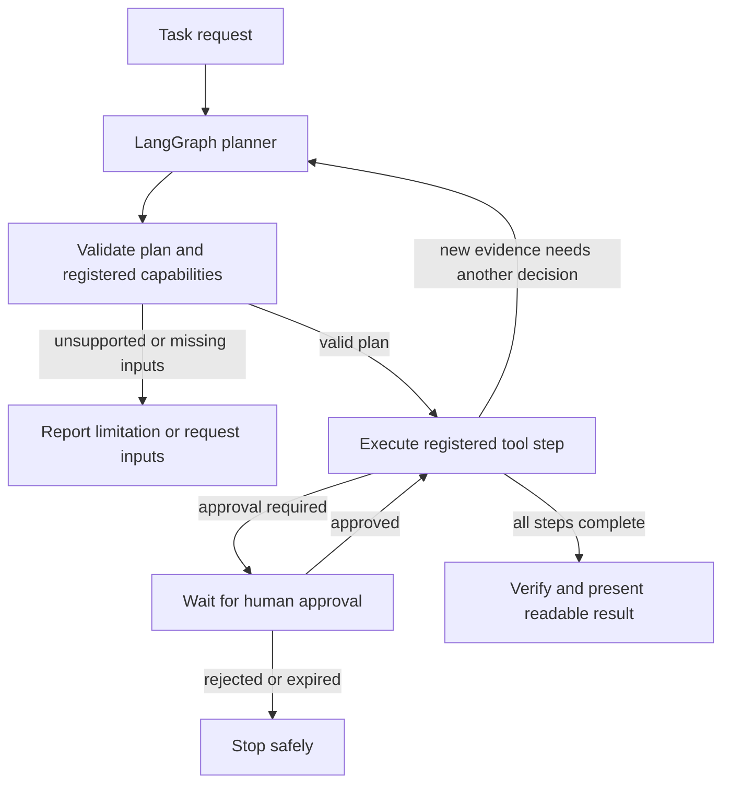

# CentrAlign AI and Ledgerly Finance Hub demo

This repository contains the CentrAlign AI Operator and a fictional Ledgerly Finance Hub website for browser-agent testing. Ledgerly provides stable invoice, vendor, purchase-order, approval, payment-run, activity, and Markdown knowledge-base pages at the routes described below. Every financial record is synthetic; the mock site cannot create an external payment or connect to a bank.

## Stack and prerequisites

- React 19 and Vite 8 frontend.
- FastAPI and Python backend for the existing task agent.
- Node.js/npm and Python 3.11+ for local development.
- Playwright Chromium is needed only when using the backend browser tool.

## LangGraph planner

The compiled `planner_graph` has one node: it prepares a tool plan from the task and context. The application workflow validates and executes registered tools, handles approvals, then invokes the planner again when new evidence needs another decision. That workflow is application orchestration outside the LangGraph graph.



The surrounding workflow is shown separately so the README does not imply those stages are LangGraph nodes:



## Start the mock portal

From the repository root:

```powershell
cd frontend
npm install
npm run dev
```

Open [http://localhost:5173/dashboard](http://localhost:5173/dashboard). The existing CentrAlign AI Operator remains at [http://localhost:5173/](http://localhost:5173/). The Operator sidebar has a Ledgerly mock site link.

## Start the existing browser agent

In another terminal, install the backend dependencies and browser runtime if needed, configure the existing backend `.env` values (including the model credentials and database settings required by this project), then run:

```powershell
cd backend
python -m pip install -r requirements.txt
python -m playwright install chromium
python -m uvicorn app.main:app --reload --host 127.0.0.1 --port 8000
```

For a visible browser window, set `BROWSER_HEADLESS=false` in `backend/.env` before starting the backend. The Ledgerly dashboard is the default starting site for website tasks that omit a URL. Set `BROWSER_DEFAULT_URL` to override it. The backend automatically prefers a running local demo server on port 4173 or 5173. Configure `BROWSER_AUTO_APPROVE=true` only if you want auto-run browser interactions on explicitly allowlisted hosts. Add comma-separated public HTTPS hostnames to `WEB_ALLOWED_HOSTS`; local loopback HTTP such as `localhost:5173` is accepted by the browser tool. If role grants are customized, grant `web:read` and `web:interact` to the appropriate role. Restart the backend after changing environment settings.

Give the agent a task without a starting URL, such as: “Review INV-2048, inspect its vendor and PO, consult invoice processing policy, and report whether it is ready for human approval. Do not initiate a payment.”

## Mock data and knowledge base

- Synthetic records: [`frontend/src/data/ledgerlyData.js`](frontend/src/data/ledgerlyData.js).
- Canonical Markdown articles: [`docs/`](docs/README.md). The frontend imports these same files at build time and renders them at `/knowledge-base`.
- Article index: [`docs/README.md`](docs/README.md).
- Product requirements: [`SPEC.md`](SPEC.md).

To add a record, update the relevant data array in `ledgerlyData.js` and maintain its linked vendor, invoice, PO, approval, run, and activity references. To add an article, add a non-empty `.md` file to an existing `docs/<category>/` directory with a title and metadata fields for Document ID, Version, and Last updated; it will appear in the rendered Knowledge Base after Vite rebuilds.

## Demo state and limitations

Invoice review actions and notes are saved in this browser's `localStorage` under `ledgerly-demo-actions`. Use **Help & role guide → Reset local demo changes** to clear that local overlay. The seeded data remains unchanged. There is no database-backed mock workflow, authentication, bank connection, payment rail, or durable accounting action in Ledgerly. `Paid` and `Simulated Complete` are reserved for explicitly seeded historical demo records. A local recommendation is not an approval.

The current demonstration includes 8 vendors, 21 invoice records, 11 purchase orders, 6 approval requests, 3 payment runs, 14 activity entries, and 35 browsable Markdown references. See the [browser setup guide](backend/BROWSER.md) for browser tool constraints.
